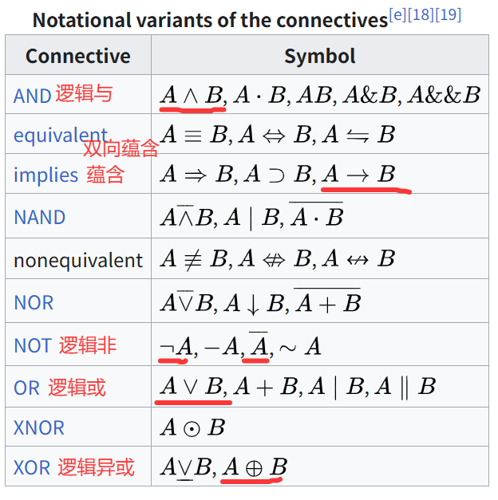
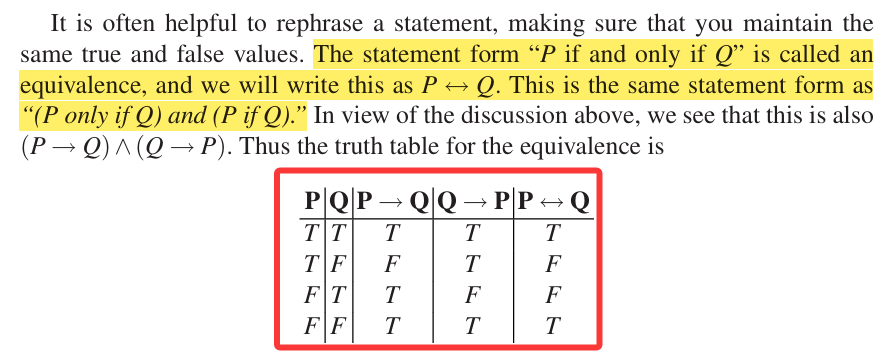
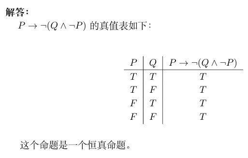
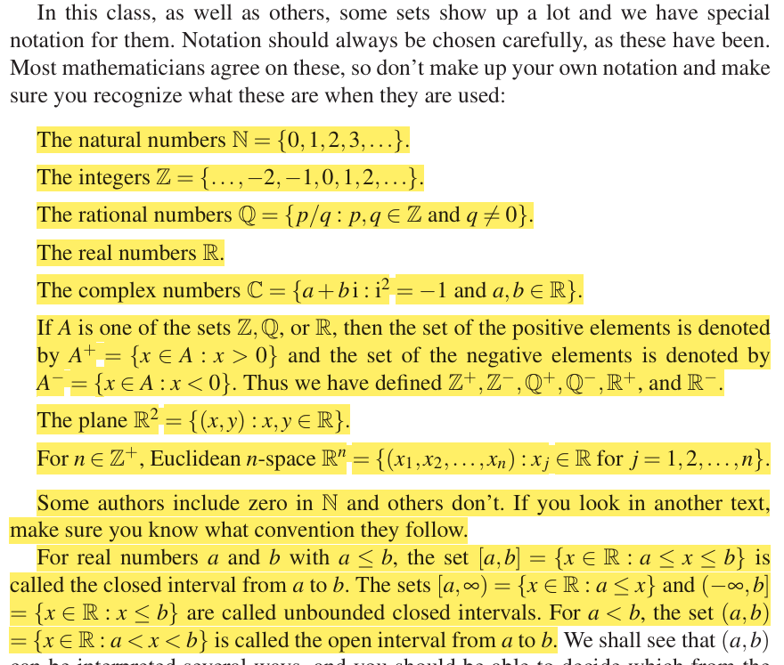
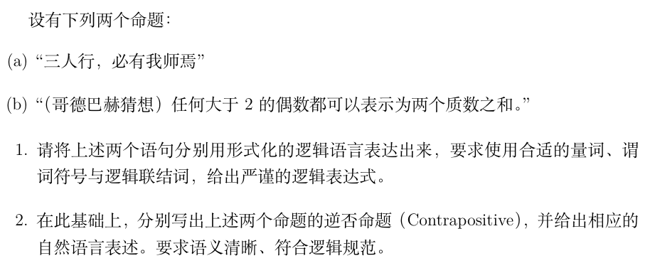
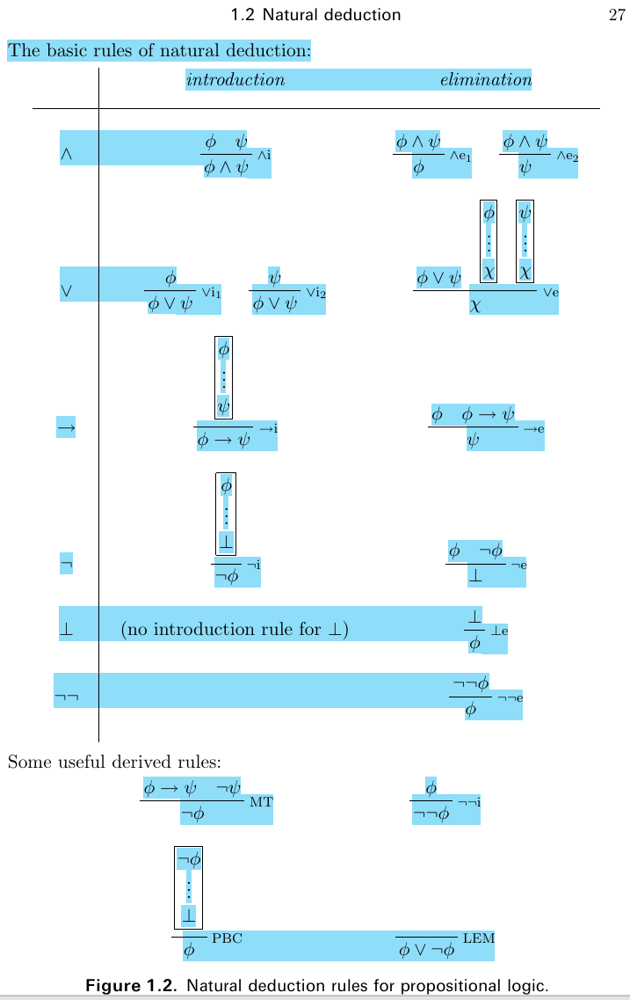
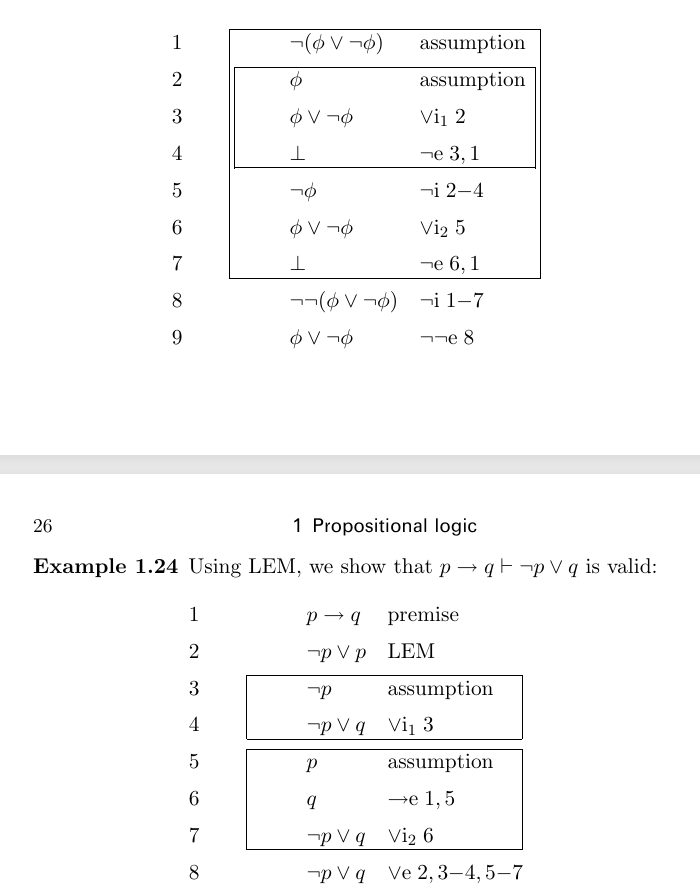

## 命题与命题逻辑

命题（statement）：能够确定真假的陈述句。

- 真（true）用 $T$ 指代，假（false）用 $F$ 指代。
- 命题通常使用大写拉丁字母 $P,Q,R,S,\cdots$ 指代。

> IIRS 果真如此吗？Is it really so?
>
> Many-valued logic (also multi- or multiple-valued logic) is a propositional or predicate calculus in which there are more than two truth values. Traditionally, in Aristotle's logical calculus, there were only two possible values (i.e., true and false) for any proposition. Classical two-valued logic may be extended to $n$-valued logic for $n$ greater than $2$.
>
> 多值逻辑是一种命题逻辑或谓词逻辑，其中包含的真理值超过两个。在亚里士多德的逻辑体系中，任何命题都只有两种可能的真理值：真和假。传统的二值逻辑可以扩展为 $n$ 值逻辑，其中 $n$ 大于 $2$.
>
> Source: Wikipedia Many-valued logic. 来源：维基百科 多值逻辑。

在经典的命题逻辑（propositional logic），也称为零阶逻辑（zeroth-order logic）中，我们定义如下连接词。

逻辑联结词（logical connective）：将命题们连接起来的符号。语法上（grammatically），这形成了新的命题，即公式（formula）；语义上（semantically），进行了逻辑值的运算。

- 逻辑非、否定（negation, NOT）：$P$ 为真则其否定 $\neg P$ 为假；$P$ 为假则其否定 $\neg P$ 为真。
- 逻辑与、合取（conjunction, AND）：$P,Q$ 皆为真，则其逻辑与 $P\land Q$ 为真；反之为假。
- 逻辑或、析取（disjunction, OR）：$P,Q$ 皆为假，则其逻辑或 $P\lor Q$ 为假；反之为真。
- 蕴含、推出（implication）：对于 $P\to Q$，若其前件 $P$ 为真且其后件 $Q$ 为假，则 $P\to Q$ 为假；反之为真。
- 双向蕴含、等价（equivalence）：对于 $P\leftrightarrow Q$，其同真或同假时其为真；反之为假。
- 真值表：对于某一公式，列出其原子命题（atomic proposition）的所有可能真值，与该情况下该公式的真值构建的表格。
- 运算顺序：$\neg, \land, \lor, \to, \leftrightarrow$ 优先级依次降低，$\neg$ 为右结合，其它为左结合。

- 重言式、永真式（tautology）：无论其原子命题取值，真值恒为真的公式。
- 矛盾式、永假式（contradiction）：无论其原子命题取值，真值恒为假的公式。
- 可满足式、可能式（contingency）：根据其原子命题有真值为真可能，且有真值为假可能的公式。

> Item 01: 2024, PS I, Week2 homework.
>
> 画出 $P\to \neg(Q\land \neg P)$ 的真值表并说明其属于重言式、矛盾式，亦或是可能式？
>
> 

针对经典二值逻辑，存在如下运算律：幂等律（L1）、交换律（L2）、结合律（L3）、吸收律（L4）、逻辑与对逻辑或的分配律（D1）、逻辑或对逻辑与的分配律（D2）、零元（B1）、幺元（B2）、矛盾律和排中律（C1）、C2、双重否定律（C3）、德摩根律（M1, M2）。

$$
\begin{aligned}
&(L1) &P\land P=P,P\lor P=P\\
&(L2) &P\land Q=Q\land P,P\lor Q=Q\lor P\\
&(L3) &P\land(Q\land R)=(P\land Q)\land R,P\lor(Q\lor R)=(P\lor Q)\lor R\\
&(L4) &P\lor(P\land Q)=P,P\land (P\lor Q)=P\\
&(D1) &P\land (Q\lor R)=(P\land Q)\lor (P\land R)\\
&(D2) &P\lor (Q\land R)=(P\lor Q)\land (P\lor R)\\
&(B1) &P\land F=F,P\lor T=T\\
&(B2) &P\land T=P,P\lor F=P\\
&(C1) &P\land \neg P=F,P\lor \neg P=T\\
&(C2) &\neg F=T,\neg T=F\\
&(C3) &\neg (\neg P)=P\\
&(M1) &\neg(P\land Q)=\neg P\lor \neg Q\\
&(M2) &\neg(P\lor Q)=\neg P\land \neg Q\\
\end{aligned}
$$

额外需要提及的一点是：$(P\to Q)\leftrightarrow (\neg P\lor Q)$.

> IIRS?
>
> Intuitionistic logic, sometimes more generally called constructive logic, refers to systems of symbolic logic that differ from the systems used for classical logic by more closely mirroring the notion of constructive proof. In particular, systems of intuitionistic logic do not assume the law of excluded middle and double negation elimination, which are fundamental inference rules in classical logic.
> 
> 直觉主义逻辑，有时也称为构造主义逻辑，是一种符号逻辑体系。它与经典逻辑的不同之处在于，它更符合「构造性证明」的概念。具体而言，直觉主义逻辑体系**不接受「排中律」**和「双重否定律」这两个在经典逻辑中非常重要的推理规则。
>
> Paraconsistent logic is a type of non-classical logic that allows for the coexistence of contradictory statements without leading to a logical explosion where anything can be proven true. Specifically, paraconsistent logic is the subfield of logic that is concerned with studying and developing "inconsistency-tolerant" systems of logic, purposefully excluding the principle of explosion.
>
> 弗协调逻辑是一种非经典逻辑形式。它**允许相互矛盾的陈述**共存，而不会导致逻辑上的「爆炸」——即不会出现任何陈述都被证明为真的情况。具体而言，弗协调逻辑属于逻辑学的一个分支，其研究目的是构建「能够容忍矛盾」的逻辑体系，从而避免逻辑上的爆炸现象。
>
> Source: Wikipedia Intuitionistic logic, Paraconsistent logic. 来源：维基百科 直觉主义逻辑、弗协调逻辑。

对于 $P\to Q$ 这么一个命题来说，我们定义几种类似的命题：

- 否定命题（negation）：$\neg (P\to Q)$.
- 否命题（inversion）：$\neg P\to \neg Q$.
- 逆命题（conversion）：$Q\to P$.
- 逆否命题（contraposition）：$\neg Q\to \neg P$.
- 定理：逆否命题和原命题同真同假。

## 集合与谓词逻辑

什么是集合？早期集合论（朴素集合论）将集合描述为「总括之全体」，并给出了两条原则：

1. **外延原则**：集合由其元素完全决定。$A=B\leftrightarrow \forall x(x\in A\leftrightarrow x\in B)$.
2. **概括原则**：对于人们直观或思维之对象 $x$ 的任一性质 $P(x)$，存在集合 $S$，其元素恰为具有性质 $P$ 的那些对象，记为 $S=\{x|P(x)\}$. 换句话说 $a\in S\leftrightarrow P(a)$.

然而，概括原则有着致命缺陷，B. Russell 在 1902 年给出性质 $P(x)=x\notin x$，其无法产生集合 $S$，此即为 Russell 悖论。人们不得不修改概括原则，用形式方法讨论集合论，即产生了公理集合论。

Zermelo 与 Fraenkel 在 20 世纪初建立了集合论的公理系统，称作 ZF 公理系统，以刻画集合：

1. 外延公理：$\forall A\forall B(\forall x(x\in A\leftrightarrow x\in B)\to A=B)$.
2. 空集公理：$\exists B\forall x(\neg (x\in B))$.
3. 对偶公理：$\forall u\forall v\exists B\forall x(x\in B\leftrightarrow (x\in u\lor x\in v))$.
4. 并集公理：$\forall A\exists B\forall x(x\in B\leftrightarrow (\exists b\in A)(x\in b))$.
5. 幂集公理：$\forall a\exist B\forall x(x\in B\leftrightarrow x\subseteq a)$.
6. 子集公理：对于任何 $S$-公式 $\varphi$，若 $FV(\varphi)\subseteq \{x_1,\cdots,x_k,x\}$ 且 $B\notin FV(\varphi)$，则 $\forall \vec{x}\forall C\exists B\forall x(x\in B\leftrightarrow (x\in C\land \varphi))$.
7. 无穷公理：$\exists A(\varnothing\in A\land (\forall a\in A)(a^+\in A))$.
8. 替换公理：对于任何 $S$-公式 $\varphi(x,y)$，其不含 $B$ 且 $FV(\varphi)=\{x,y,t_1,\cdots,t_k\}$，则
    $$
    \forall\vec{t}\forall A((\forall x\in A)(\forall y_1\forall y_2(\varphi(x,y_1)\land \varphi(x,y_2)\to y_1\doteq y_2)\to \exists B\forall y(y\in B\leftrightarrow (\exists A)(\varphi(x,y)))))
    $$
9. 正则公理：$\forall A(\neg(A=\varnothing)\to(\exists a\in A)(a\cap A=\varnothing))$.

- 选择公理（AC）：$\forall A\exists \tau((\tau :P(A)-\{\varnothing\}\to A)\land (\forall B\in (P(A)-\{\varnothing\}))(\tau(B)\in B))$，其中 $\tau$ 称为选择函数。

> 关于空集公理：由外延公理可知空集唯一，并记为 $\varnothing$. 在 Russell 的 $\iota$-算子的语言中，$\varnothing$ 即 $\iota B.\forall x(\neg(x\in B))$. 若 $S$ 中有常元 $\varnothing$ 则空集公理可直接记为 $\forall x(x\notin \varnothing)$.
>
> 关于对偶公理：这样的 $B$ 存在且唯一，若 $S$ 中有函数 $\{,\}$，则对偶公理可直接记为 $\forall u\forall v(x\in\{u,v\}\leftrightarrow (x=u\lor x=v))$.
>
> 关于并集公理：这样的 $B$ 存在且唯一，若 $S$ 中有函数 $\cup$，则并集公理可直接记为 $\forall A\forall x(x\in \cup A\leftrightarrow (\exists b\in A)(x\in b))$，若取 $A=\{u,v\}$，则可定义并：$\forall x(x\in u\cup v\leftrightarrow (x\in u\lor x\in v))$.
>
> 关于幂集公理：这样的 $B$ 存在且唯一，若 $S$ 中有函数 $\mathcal{P}$，则幂集公理可直接记为 $\forall x(x\in\mathcal{P}(a)\leftrightarrow x\subseteq a)$.
>
> 关于子集公理：这样的 $B$ 存在且唯一且为 $C$ 的子集，以 Cantor 的概括符号，$B$ 可表示为 $\{x|x\in C\land \varphi\}$ 或 $\{x\in C|\varphi\}$，这就修正了原本的概括原则，从而避免了 Russell 悖论。
>
> 关于无穷公理：这样的 $A$ 不唯一，称这样的 $A$ 为归纳集，记作 $\operatorname{Ind}(A)$. 取 $A$ 由无穷公理保证存在的归纳集合，令 $N=\{x|x\in A\land \forall B(\operatorname{Ind}(B)\to x\in B)\}$，由子集公理知这样的 $N$ 存在，并被定义为自然数集。若定义 $0\triangleq \varnothing,\operatorname{Suc}(n)=n^+$，则可证明 $(N,0,\operatorname{Suc})$ 为 Peano 算术模型。
>
> 关于替换公理：使用集合论符号即：对于函数 $F$ 和集合 $A$，$F(A)$ 同样为一个集合。
>
> 关于选择公理：其存在许多等价的表达，因一些等价的表达看上去显然正确，而另一些看上去显然错误，所以选择问题是否应纳入体系就具有争议，下面是一个等价的表达：
>
> > [!Note]
> >
> > Zorn 引理：设 $S$ 为偏序集，若 $S$ 中的每个链皆有界，则 $S$ 有极大元。
>
> 集合论的公理体系 ZF 不包括 AC，纳入 AC 的公理体系称为 ZFC。同时我们有著名的独立性结果：$\operatorname{con}(\text{ZF})\Rightarrow \operatorname{con}(\text{ZF}+\text{AC}),\operatorname{con}(\text{ZF})\Rightarrow \operatorname{con}(\text{ZF}+\neg \text{AC})$，即 AC 独立于 ZF.

上述太复杂，完全不用看，高中知识够用。

> IIRS?
>
> 注意到公理集合论本身使用包含集合语言的一阶逻辑来定义，这合适吗？
>
> 因此集合成为了一个原语（primitive），即一个原始的概念。如若要精确地刻画集合，则需要比集合还要底层的概念，例如使用 Gödel 编码，但显然这将引出「存在最底层的概念吗？如果有那么是什么？」的追问。

借助于集合的概念，我们引入量词（quantifier）和谓词（predicate）的概念，进而引入谓词逻辑（predicate logic），亦称为一阶逻辑（first-order logic）。

使用谓词来刻画个体（individual），个体分为个体常元（constant）和个体变元（variable）。谓词可以看作成一个函数，其仅输出真值。

使用量词来刻画域（domain），通常为集合。一阶逻辑中的量词包括全称量词（universal quantifier）和存在量词（existential）。

- 全称量词 $\forall$ 表示「对于……，都有……」，例如 $p(x)$ 表示 $x$ 是否是正数，那么 $\forall x,x\in\mathbb{Z}\to p(x^2)$ 就表示，对于所有整数 $x$，$x^2$ 都是正数。当然这是假的，因为 $x=0$ 时不满足这一点。
- 存在量词 $\exists$ 表示「对于……，存在一个有……」，例如 $\exists x, x\in\mathbb{Z}\to \neg p(x^2)$ 就表示，对于所有整数 $x$，存在一个 $x$ 使得 $x^2$ 不是正数。这是真的。
- 谓词通常使用大写拉丁字母 $P, Q, R, S, \cdots$ 表示，个体常元通常使用小写拉丁字母 $a, b, c, d, \cdots$ 表示，个体变元通常使用小写拉丁字母 $x, y, z, w, \cdots$ 表示。

关于一阶逻辑的公式，有这么几点：

- 相邻全称量词可以交换顺序，相邻存在量词也可以交换顺序，但是相邻全称量词和存在量词不能轻易调换顺序。e.g. 收敛与一致收敛。
- $\forall x, P(x)$ 的否定等价于 $\exists x, \neg P(x)$；$\exists x, P(x)$ 的否定等价于 $\forall x, \neg P(x)$.

> Item 02: 2025, PS I, final exam
>
> 
>
> 1.(a) 设谓词 $P(x, y, z)$ 表示 $x, y, z$ 走在一起，$A$ 为人的集合，$B$ 为我师的集合，那么原命题可以表述为：$\forall x,\forall y,\forall z, x\in A\land y\in A\land z\in A\land P(x, y, z)\to x\in B\lor y\in B\lor z\in B$.
> 1.(b) 
> $$
> \forall x, (x\in \mathbb{Z}\land 2\mid x\land x>2)\to (\exists y, \exists z, y\in\mathbb{Z}\land z\in\mathbb{Z}\land y>1\land z>1\land\\ \neg (\exists w, w\in\mathbb{Z} \land w > 1\land w\ne y\land w\mid y)\land \neg (\exists w, w\in\mathbb{Z} \land w > 1\land w\ne z\land w\mid z)\land x = y + z)
> $$
> 2.(a) $\forall x, \forall y, \forall z, \neg (x\in B\lor y\in B\lor z\in B)\to \neg (x\in A\land y\in A\land z\in A\land P(x, y, z))$.
> 2.(b)
> $$
> \forall x, \exists y, \exists z, \neg (y\in\mathbb{Z}\land z\in\mathbb{Z}\land y>1\land z>1\land \neg (\exists w, w\in\mathbb{Z} \land w > 1\land w\ne y\land w\mid y)\\\land \neg (\exists w, w\in\mathbb{Z} \land w > 1\land w\ne z\land w\mid z)\land x = y + z)\to \neg ((x\in \mathbb{Z}\land 2\mid x\land x>2)) 
> $$

## 自然推理系统

一图胜千言。

- 重言 $\top$，矛盾：$\bot$，$\bot\mathrm{e}$ 即爆炸原理。
- MT 即分离规则 Modus Ponens，此拉丁语意为「前件肯定」。PBC 即反证法（proof by contradiction）、LEM 即排中律（law of excluded middle）。

如下为一个证明的例子：

那么，为什么要引入自然推理系统呢？我们前文说过，逻辑联结词包含了语法上和语义上的功能。前文借助 Boole 逻辑给出了其语义，现在通过证明说明这个系统的语法。

这引出了一个问题：对于公式集 $\Gamma$ 和公式 $P$，我们称 $\Gamma$ 语法上能推出 $P$ 指的是存在一个证明；称 $\Gamma$ 语义上能推出 $P$ 指的是对于所有使得 $\Gamma$ 中公式都为真的原子命题真值取值，$P$ 在该情况下真值同样为真。**问题：语义上能推出和语法上能推出是等价的吗？**

我们定义两个概念，可靠性（soundness）：语义上推出必然有语法上推出，即可证必为真；完全性、完备性（completeness）：语法上推出必然有语义上推出，即真必然可证。

一般而言，我们会要求逻辑体系可靠性必须成立。那么问题在于完全性。

对于经典命题逻辑，可靠性和完全性都成立。对于经典的一阶逻辑（尽管我们没有介绍它的语法），完全性也成立，此为 Gödel 完全性定理。

然而，对于 ZFC 公理体系，完全性不成立，即存在某些公式，其是真命题，但是不存在其证明，此即为有名的 Gödel 不完全性定理。

这里，我们略去了模型论的一些背景知识，只是以简单的形式介绍大概的图景。

## 证明方法

首先 UD Chapter 5 中介绍了如下几种方法：

- 直接证明（direct proof）。
- 反证法（proof by contradiction）。
- 分类讨论（proof in cases）。

直接证明即拿着题设，一步步使用公理、定义、定理等，推出结论，这自然构成了一个证明。

反证法则是拿着题设，并假设结论不成立，并导出一个矛盾，从而构成一个证明。

分类讨论则是将某对象空间划分（不重不漏，并全交空）为若干子空间，在各个子空间中分别证明结论成立，从而构成一个证明。

UD Chapter 18 中介绍了数学归纳法（principle of mathematical induction），此方法依赖自然数集（或其子集）的良序性。具体来说，对于一系列命题 $P(0), P(1), \cdots$，我们可以通过如下方法给出一个证明：

1. 奠基：$P(0), P(1), \cdots, P(i)$ 均成立。

2. 假设 $P(k), k\ge i$ 时成立，并给出此时 $P(k +1)$ 亦成立。

3. 那么 $P(0), P(1), \cdots$ 均成立。

数学归纳法（亦称第一数学归纳法）有其等价版本，即强数学归纳法（已成第二数学归纳法），其将如上过程略加修改：

1. 奠基：$P(0), P(1), \cdots, P(i)$ 均成立。

2. 假设 $P(1)\land P(2)\land \cdots P(k), k\ge i$ 时成立，并给出此时 $P(k +1)$ 亦成立。

3. 那么 $P(0), P(1), \cdots$ 均成立。

需要注意的是，数学归纳法只能证明对于所有自然数 $n$ 有 $P(n)$ 成立，但无法证明对于无穷基数 $\omega$ 有 $P(\omega)$ 成立。

ES Section 24 介绍了鸽笼原理（pigeonhole principle）亦称抽屉原理。

鸽笼原理形式化地说就是，对于函数 $f:A\to B$，若 $|A|>|B|$，则 $f$ 必然不可能为单射。

> e.g. 不含重复数的长为 $n^2+1$ 的序列必然存在至少长 $n+1$ 的单调子序列。
>
> 反证法，记录 $(l_i, r_i)$，其中 $l_i$ 为 $a_i$ 起的最长单调递增子序列长，$r_i$ 为 $a_i$ 起的最长单调递减子序列长，因假设不存在长为 $n+1$ 的单调子序列那么必然存在 $i,j$ 使得 $l_i=l_j,r_i=r_j$.
>
> 不妨设 $i<j$，那么此时我们比较 $a_i$ 和 $a_j$，$a_i<a_j$ 将导致 $l_i=l_j+1$ 矛盾；$a_i>a_j$ 将导致 $r_i=r_j+1$ 矛盾；
>
> 这导出了一个矛盾，故假设不成立，原结论成立。Q.E.D.

ES Section 24 还介绍了 Cantor 的对角线法。这包含如下结论：

- 不存在 $A\to 2^A$ 的满射。
- 最小的无穷集大小和自然数集一样，即与自然数集等势，并将该大小记作 $|\mathbb{N}|=\aleph_0$（aleph null）.
