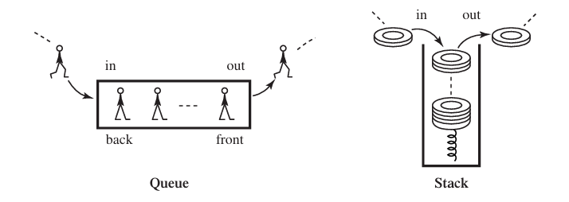
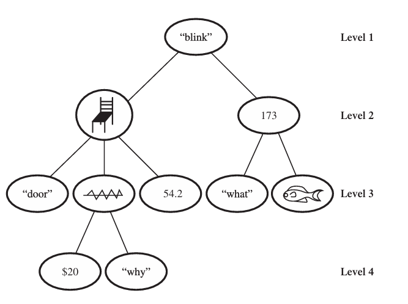

### 一些概念

算法（algorithm）给定输入（input），按照**确定流程**输出输出（output）。

对于一个算法，我们要怎么实现它呢？我们使用计算机（computer）来实现。对于实际的部件，即硬件（hardware），其计算结果并返回给上层，上层就是软件（software），描述算法的逻辑形成程序（program）。

运行（run）、执行（execute）实现了某算法的程序，就可以输入输入，获得输出。

对于所有问题中，存在算法解答的问题称为可计算问题（computable problem, algorithmic problem）。

接下来我们介绍计算机，即硬件部分。

### 图灵机

见 LB1: 计算机基础知识。

### 计算机体系结构简论

见 LB1: 计算机基础知识。

### 结构化程序设计

DH Chapter 2 中介绍了控制流结构（control-flow structure）或者说控制结构（control structure）。

其将算法的控制流归于三种：顺序执行（direct sequencing）、条件分支（conditional branching）、循环结构（iteration, looping strcture）

结构化程序定理（structured program theorem）表明：使用「顺序结构」、「条件判断」、「循环」三种方式组合程序，可以表达任何可计算函数（computable function）。

> Question: 什么是可计算函数？
>
> Computable functions are the basic objects of study in computability theory. Informally, a function is computable if there is an algorithm that computes the value of the function for every value of its argument. Because of the lack of a precise definition of the concept of algorithm, every formal definition of computability must refer to a specific model of computation.
>
> 可计算函数是可计算性理论中的基本研究对象。通俗来说，如果存在一种算法，能够针对该函数的每一个参数值来计算出相应的函数值，那么这个函数就是可计算的。由于「算法」这一概念缺乏精确的定义，因此，关于可计算性的任何正式定义都必须参照某种具体的计算模型来进行阐述。
>
> Many such models of computation have been proposed, the major ones being Turing machines, register machines, lambda calculus and general recursive functions. Although these four are of a very different nature, they provide exactly the same class of computable functions, and, for every model of computation that has ever been proposed, the computable functions for such a model are computable for the above four models of computation.
>
> 人们提出了许多这样的计算模型，其中最著名的包括图灵机、寄存器机、Lambda 演算和通用递归函数。尽管这四种模型的本质各不相同，但它们所能够计算的函数类别是完全相同的。而且，对于迄今为止所提出的每一个计算模型来说，该模型所能计算的函数，也都可以通过上述四种模型来计算。
>
> Source: Wikipedia Computable function. 来源：维基百科 可计算函数。

关于循环，分为两种：有边界循环（bounded iteration）和无边界循环（unbounded iteration）亦称条件循环（conditional iteration）。

当然，如上结构可以进行嵌套（nest），算法之间可以进行调用，自我调用称为递归（recursion）。

> e.g. 河内塔 Towers of Hanoi.
>
> 河内塔，是一个源于印度古老传说的益智玩具。大梵天创造世界的时候做了三根金刚石柱子，在一根柱子上从下往上按照大小顺序摞着 64 片黄金圆盘。大梵天命令婆罗门把圆盘从下面开始按大小顺序重新摆放在另一根柱子上。并且规定，在小圆盘上不能放大圆盘，在三根柱子之间一次只能移动一个圆盘。
>
> 来源：百度百科。
>
> ```python
> def hanoi(n, a, b, c):
>     if n == 1:
>         print(a, '-->', c)
>     else:
>         hanoi(n - 1, a, c, b)
>         print(a, '-->', c)
>         hanoi(n - 1, b, a, c)
> hanoi(5, 'A', 'B', 'C')
> ```

而在结构化程序设计之前，人们使用顺序结构和 `goto` 跳转，在工程上，这会使得代码不可维护，因此 Dijkstra 提出 `goto` 有害论。在其影响下，`goto` 跳转被受限的分支结构和循环结构所代替。

结构化程序设计解决了「数据流」、「指令流」、「控制流」中的控制流问题。接下来我们讨论数据。

### 数据类型与数据结构

数据在计算机中以二进制形式存储，但是一样的二进制代表一样的数据吗？当然不是，例如字符、整数、小数当然都不一样，所以引入了数据类型（data type），但是数据类型是由软件维护的，而不是硬件。

数据当然也要合理摆放才能维护，因此，如果我们有很多数据，那么我们会使用数据结构（data stucture）存储和维护它们。

我们接下来介绍一些常用的数据结构。请记住，我们通常需要讨论数据结构的增删查改（CRUD: create, read, update, delete）。

一、数组

出于一些历史原因，定长数组称为 array，变长数组称为 vector 或列表（list）。请注意定长和变长指的是初始分配的空间是否可以更改。

数组就是在一块连续的存储器上，连续地存放相同数据类型的数据结构，我们可以使用**从零开始的下标（index）**访问第几个数据。

- 增：长度允许的情况下直接修改对应位置的数据：`A[l] := 1; l := l + 1;`.
- 删：长度允许的情况下直接修改对应位置的数据：`A[1] := undefined;`.
- 查：长度允许的情况下直接访问：`x := A[0];`.
- 改：长度允许的情况下直接修改：`A[0] := 1;`.

如果长度不足呢？定长数组表示无法办到，这通常导致一个错误；变长数组一般会申请一块新的空间以进行存储。

当然，数组可以嵌套数组，即某数组的元素是另一个数组。

二、栈和队列

栈（stack），亦称后进先出表（LIFO 表，last-in-first-out）。

队列（queue），亦称先进先出表（FIFO 表，first-in-first-out）。



对于栈来说，其 CRUD 是：

- 增：将元素压入栈中 `S.push(x);`.
- 删：将元素弹出栈 `S.pop(x);`.
- 查：查询栈顶元素 `x := S.top();`.
- 改：不支持。

对于队列来说，其 CRUD 是：

- 增：将元素压入队尾 `Q.push(x);`.
- 删：将队首元素弹出队列 `Q.pop(x);`.
- 查：查询队首元素 `Q.front();`.
- 改：不支持。

> 双端队列（double-enede quque）是一种扩展的队列，其 CRUD 为：
>
> - 增：将元素压入队首或队尾：`D.push_front(x);`、`D.push_back(x);`.
> - 删：将队首或队尾元素弹出：`D.pop_front(x);`、`D.pop_back(x);`.
> - 查：查询队首或队尾元素：`x := D.front(); y := D.back();`.
> - 改：不支持。

三、树形数据结构

我们如此定义图（graph）：其表为一个二元组 $\langle V, E\rangle$，其中 $V$ 为点（vertex）集合，$E$ 为边（edge）集合，每条边集中的边由两个点集中的点构成的二元组定义，如若该二元组为有序二元组则图为有向图；若该二元组为无序二元组则图为无向图。对于有向图，$e=(u,v)$ 则 $u$ 是起点，$v$ 是终点。而无论有向边、无向边，都称 $e$ 与 $u,v$ 关联。

由点开始，到点结束，点边交替的序列，每条边在边集中且和相邻的点相关联【有向图则是序列中 $u,e,v$ 必须要有 $e=(u,v)$】，这样的序列称为一条路径（path）。首尾相同的路径称为一个圈（cycle）。

对于无向图，若每一个点和其它点都存在路径，那么称图连通（connected），没有圈的无向连通图称为树（tree）。

直观上来说，树是如下的图形，树中的点也称为节点（node）：



其中我们可以指定的一个点为树的根（root），然后按照和根的路径（不难发现树终这样的路径是唯一的）长度划分层次。节点到根的路径我们称为根链。

直接连接的上级节点称为该节点的父节点（parent node, father node），直接连接的下级节点称为该节点的子节点（child node, son node），拥有相同父节点的节点互称兄弟节点（sibling node, brother node）。

根链中的节点都称为该点的祖先节点（ancestor node），反过来该点是这些点的后代节点（descendant node），某点的所有后代节点及其相互连接的树中的边构成以该点为根的子树（subtree）。没有子节点的节点称为叶节点（leaf node）。

每个节点到根节点的路径长度称为该节点的高度（height）或深度（depth），最大的节点高度称为整棵树的高度。

树形数据结构有很多，并且都比较复杂。

> e.g. 堆、二叉搜索树（BST, binary search tree）、平衡二叉搜索树（balanced tree）。

我们来介绍二叉堆（binary heap），二叉堆首先是二叉树（每个节点的子节点至多为两个），然后二叉堆要求维护堆性质：父节点元素大于/小于其子节点。

不难发现根节点元素必定是最大/最小的，分别将此时的堆称为最大堆和最小堆，下面以最小堆为例子。

- 增：如果是空堆，则新节点直接成为根；否则首先随意令新节点成为某叶节点的儿子，然后比较该新节点和父节点，如果更小则交换新节点和父节点的元素，此时新节点高度可能减小，然后继续这一过程直至无法交换。不难发现堆性质仍然成立。
- 删：空堆报错；选择其子节点中元素较小的一个交换，直至该节点成为叶节点，此时直接删去。
- 查：查询堆顶，即全局最小元素。
- 改：不支持。

四、数据库和知识库

这是一类专门用于存储数据的程序，也使用自己的语言（例如 SQL）来进行 CRUD.

### 编程语言

接下来我们讨论「数据流」、「指令流」、「控制流」中的「指令流」，换句话说就是编写程序使用的编程语言。

编程语言无高下之分【梗：最好的编程语言 PHP】，但是按照出现顺序，划分为五代：

1. 第一代，机器级语言。这种语言直接使用机器码。

2. 第二代，汇编语言（assembly language）。这种语言将机器码直接写为一一对应的注记符号。

3. 第三代，高级编程语言（high-level programming language）。这种语言将汇编语言进行更高级的抽象，普遍支持结构化程序设计。例如 C、C++、Java、Python 都属于高级编程语言。

4. 第四代，领域特定编程语言（domain specific programming language）。这种语言用于特定领域，通常不是通用编程语言（即图灵完备的）。例如 SQL、R、Unix Shell.

5. 第五代，第五代编程语言（fifth generation programming language）。这种语言指明约束和逻辑，机器自己在这样的限制下解决问题。例如 Prolog、Mercury.

其中值得一提的是 C 语言作为最为成功的语言之一，其设计影响了大批后来的编程语言，一般来说我们推荐使用 C 语言教学编程。

对于每种语言，使用其写成的程序需要交给编译器（compiler，包括解释器和狭义的编译器），编译器这种软件将其转化为机器码，计算机才能按照机器码执行。

编译器通常先使用词法分析器（lexer）将程序划分为若干词法单元（token），然后使用语法分析器（parser）分析程序是否有语法错误，然后使用语义分析器分析程序是否有语义错误，然后生成中间表示（intermediate representation）并进行优化，最后生成目标代码。

如上概念可以类比自然语言，例如，在中文语句中出现「やりますね」通常是不被允许的，因为这些字符并不是中文字符，所以这将产生词法错误。而中文语句「他休息了礼物。」则将产生语法错误，因为「休息」后面并不能接名词「礼物」。中文语句「无色的绿色想法正在狂躁地睡觉。」将产生语义错误，因为「无色」和「绿色」是矛盾的，「狂躁地睡觉」是不合理的，「想法睡觉」也是不合理的。

并行与并发：并发（concurrency）通过快速切换，能够在一段时间内「看似执行多个任务」；而并行（parallel）则是真正地在一段时间内同时执行多个任务。

编程语言不止有五代的划分，还有编程范式（paradigm）的划分：

1. 命令式（imperative）编程语言。例如 C 和 Python.

2. 函数式（functional）编程语言。例如 Lisp, Haskell、Ocaml.

3. 逻辑式（logic）编程语言。例如 Prolog.

命令式编程语言中还有面向对象的（object-oriented）。请注意编程范式之间并不是绝对的，许多命令式编程语言引入了 Lambda 表达式或匿名函数以利用函数式编程的有点。

更详细的内容在 LB 中介绍。

### 算法方法

在 LB 中详细介绍，此处简略介绍。

搜索（search）与遍历（traversal）：对于一个问题，可能有很多种解答，这构成了解空间（solution space）。搜索即逐一选取解空间中的解，验证后得到最终答案；遍历是该解空间形成了某种结构的特殊情况。

分治（divide-and-conquer）：对于一个问题，将其**划分**为若干仅规模不同的子问题，利用子问题的答案可以解决母问题，这种将其划分为子问题，再利用子问题答案解决母问题的算法称为分治法。

贪心（greedy algorithm）：对于一个问题，按照某种策略，仅保留某一种或某几种答案，最后得出最终答案。这种策略依赖最优性质。e.g. 求一个序列的最大元素。

动态规划（dynamically programming）：对于一个问题，其**包含**了若干子问题，这些子问题通常被分为若干类，通过几类子问题的答案，可以得到最终答案。


