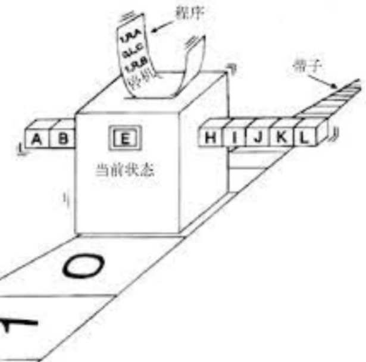
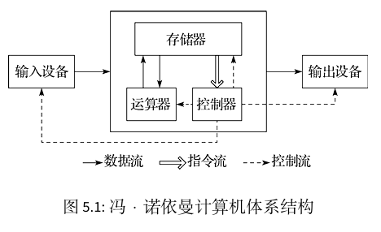
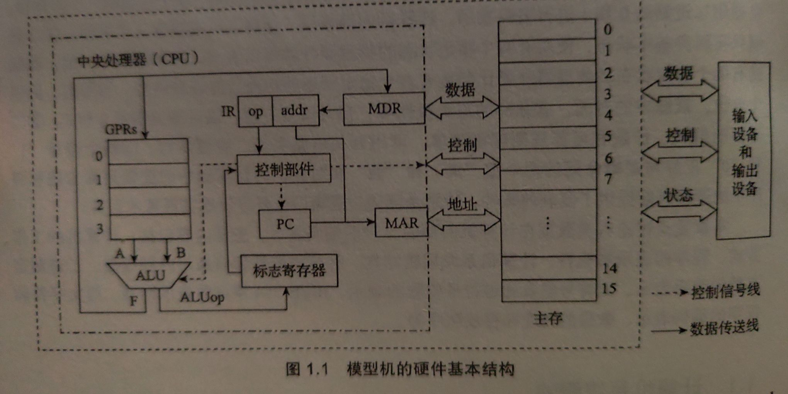

### 二进制

我们平常所用的十进制数字可以看作是一种级数求和：$a_{n-1}\cdots a_1a_0.a_{-1}\cdots_{(10)}=\sum_{i=-\infty}^{\infty}a_i\times 10^i$.

将底数 $10$ 换为 $2$，我们就得到了数的二进制表示：$b_{n-1}\cdots b_1b_0.b_{-1}\cdots_{(2)}=\sum_{i=-\infty}^{\infty}b_i\times 2^i$.

不过有些类似于二进制的表示有其它规则，例如补码和浮点数表示。

### 图灵机

我一直认为 PS1 不讲图灵机是一种遗憾。

> A Turing machine is a mathematical model of computation describing an abstract machine that manipulates symbols on a strip of tape according to a table of rules. Despite the model's simplicity, it is capable of implementing any computer algorithm.
>
> 图灵机是一种计算模型，它描述了一种抽象的机器：这种机器能够根据预先设定的规则来操作磁带上的符号。尽管该模型的结构相当简单，但它却能够实现任何计算机算法。
>
> Source: Wikipedia Turing machine. 来源：维基百科 图灵机

直观上，图灵机模型包含如下事物：一条无限长而划分为无限多个小格的纸带，一台读写头指向纸带上某一格子、且有一个状态的机器，一张指令表。

另外，我们有一个符号集合，记录了这个模型中用到的所有符号。

纸带的各个格子上有有限个符号，除此之外都是空的。机器的读写头指向纸带上某一格子，每次机器检查读写头指向的格子上是什么符号（或者是空格子），并检查自己是什么状态。

指令表记录了机器处于什么状态，读写头指向什么符号应该做什么，包括：

1. 机器的状态改变为何种状态？

2. 读写头指向的格子符号应变更为何种符号？

3. 纸带向左移动还是向右移动？

特别地，所有状态中有一些状态称为「接受状态」，一旦机器处于某个接受状态，则停止并给出「接受回答」；否则机器将一直运行下去。

形式化地，如上图灵机被表示为七元组 $M=\langle  Q, \Gamma, b, \Sigma, \delta, q_0, F\rangle$，其中 $Q$ 为有限非空的状态集合，$\Gamma$ 为有限非空的符号集合，$b$ 是空白符号，$\Sigma\subseteq\Gamma\setminus b$ 为初始纸带上符号的集合，$q_0\in Q$ 为初始状态，$F\subseteq Q$ 为接受状态集合，$\delta:(Q\setminus F)\times \Gamma\to Q\times \Gamma \times \{L, R\}$ 为表示指令表的转移函数，$L,R$ 分别表示纸带左移或右移。

另外将 $\{L, R\}$ 修改为 $\{L, R, N\}$ 即增加纸带不动的选项，不会对计算能力造成什么影响，简单地说就是新的机器和图灵机是等价的。

图灵机是现代计算机采用的模型，纸带（tape）就是内存（memory）、读写头（processor）就是 CPU、指令表（rulebook）就是程序（program）。

### 计算机体系结构简论

> 关于计算机体系结构，参见[计算机体系结构基础_基于LoongArch_第三版 引言](https://foxsen.github.io/archbase/%E5%BC%95%E8%A8%80.html#%E8%AE%A1%E7%AE%97%E6%9C%BA%E4%BD%93%E7%B3%BB%E7%BB%93%E6%9E%84%E7%9A%84%E7%A0%94%E7%A9%B6%E5%86%85%E5%AE%B9)。

最早的计算机都采用固定程序设计，就如同图灵机中指令表确定好了，例子是计算器。但这显然不利于进行更复杂算法的运行，因此提出了「存储程序计算机（stored-program computer）」。现代计算机普遍采用冯诺依曼结构（Von Neumann architecture），其特点如下：

1. 计算机由存储器、运算器、控制器、输入设备和输出设备五部分组成，其中运算器和控制器合称为中央处理器（Central Processing Processor，简称 CPU）。

2. 存储器是按地址访问的线性编址的一维结构，每个单元的位数固定。

3. 采用存储程序方式，即指令和数据不加区别混合存储在同一个存储器中。

4. 控制器通过执行指令发出控制信号控制计算机的操作。指令在存储器中按其执行顺序存放，由指令计数器指明要执行的指令所在的单元地址。指令计数器一般按顺序递增，但执行顺序可按运算结果或当时的外界条件而改变。

5. 以运算器为中心，输入输出设备与存储器之间的数据传送都经过运算器。

因为现代计算机体系结构过于复杂，我们给出一种简化的模型机结构：

我们可以将其和冯诺依曼结构对照。

如上是硬件结构，在软件层面，我们设计了指令系统，其包括操作码和操作数，CPU 通过一些手段将主存内数据和寄存器数据进行传送，CPU 仅操作寄存器进行运算。

PC 即程序计数器（program counter），在无跳转指令的情况下，默认增加一条指令的长度，换句话说，这对应了程序设计中的**顺序结构**。

而在有跳转指令的情况下，程序计数器将被修改，这就使得接下来的指令是某一处的指令，这对应了 **`jump`** 或者说 **`goto`**.

而自从 Dijkstra 提出 `goto` 有害论以来，在软件层面写 `goto` 被严加限制，最终形成了具有同等能力的「结构化程序设计」，即将流程控制限制为「顺序结构」、「分支结构」、「循环结构」。

